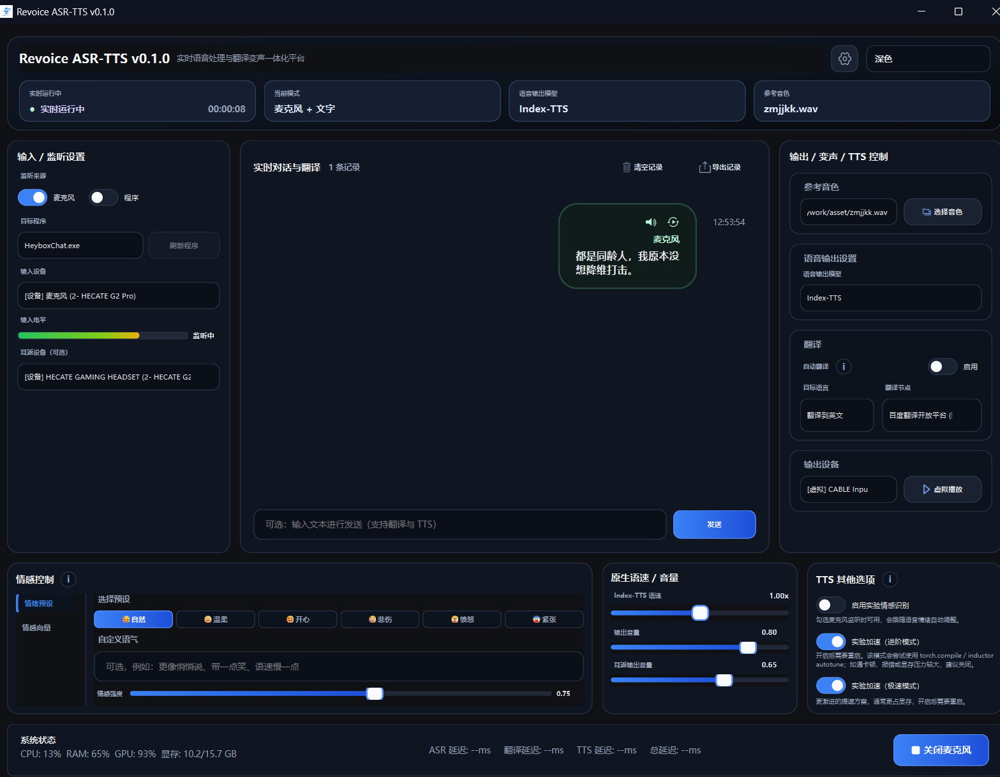
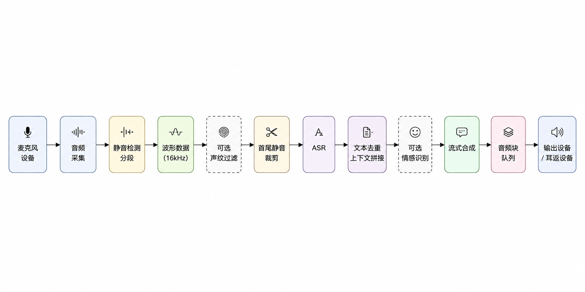
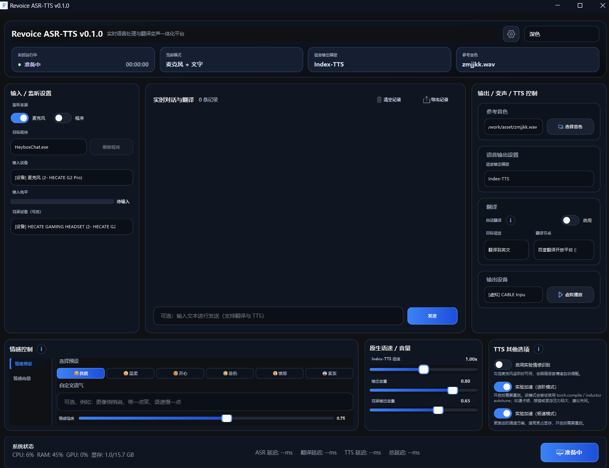
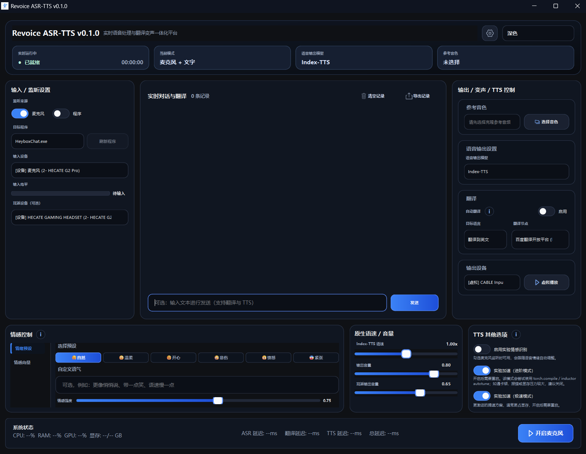
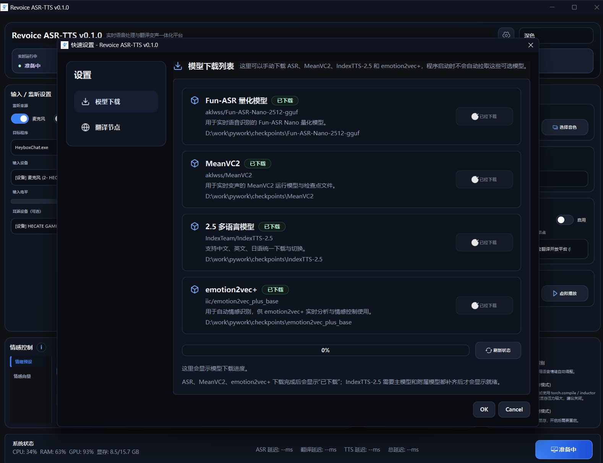

# Revoice ASR-TTS

[简体中文](./README.md)

`Revoice ASR-TTS` is a Windows real-time speech workstation built on `PySide6`, `FunASR Nano GGUF`, `IndexTTS-2.5`, `MeanVC2`, and an experimental `emotion2vec+` emotion recognition pipeline.



## Project Overview

- Real-time microphone voice changing: Microphone input -> ASR -> TTS -> Playback output
- Text mode: Direct text input for speech synthesis
- Reference audio voice cloning: Supports selecting reference audio for runtime warm-up
- Experimental emotion recognition: Automatically recognizes microphone speech emotion and maps it to TTS emotion vectors
- Desktop UI: Features a dual-layer progress bar during startup, with a main interface optimized for real-time operation

## Core Features

- `FunASR Nano GGUF` for real-time speech recognition
- `IndexTTS-2.5` for multilingual streaming speech synthesis
- `MeanVC2` for real-time voice conversion
- `emotion2vec+` for experimental emotion recognition
- Microphone, playback, and monitor devices can be configured separately
- Supports microphone input, program capture, and dual-input mode
- Supports reference audio warm-up to reduce first-sentence latency
- Built-in duplicate ASR text suppression to prevent feeding the same sentence repeatedly to TTS

## Tech Stack

- Python `3.13`
- `PySide6`
- `torch` / `torchaudio` / `torchvision`
- `sounddevice` / `soundfile` / `librosa`
- `funasr`
- `indextts`
- `modelscope`

## Project Structure

```text
.
|- app/                  # Core configuration, service layer, model wrappers
|- ui/                   # Qt UI, splash screen, worker threads
|- vendor/               # Local vendored dependencies, e.g., index-tts
|- bin/                  # Local runtime directory, must be prepared manually, not distributed with the repo
|- checkpoints/          # Model directory
`- main.py               # Python entry point
```

## Operating Principle



## UI Preview

Main Interface (Initializing):



Main Interface (Ready):



Quick Settings and Translation Node:



## Environment Requirements

- OS: `Windows` recommended
- Python: `3.13.x`
- GPU: NVIDIA GPU with CUDA support recommended for better TTS performance
- Audio Environment: Prepare a working microphone, playback device, and virtual sound card or monitor device

## Quick Start

### 1. Install Dependencies

```bash
uv sync
```


Additional runtime dependencies must be prepared manually:

- `ffmpeg`: Install to your system `PATH`, or manually place it at `bin/ffmpeg/bin/ffmpeg.exe`
  - The Windows packaging script defaults to **not** bundling the local `ffmpeg` into the distribution directory; if strictly needed, explicitly use `-IncludeBundledFfmpeg`
  - Note: If you distribute the `ffmpeg` binaries bundled with this project, handle them according to their own licenses, not the root `MIT` license of this repository
  - The current local `bin/ffmpeg` example is `FFmpeg 7.1.1 full_build (gyan.dev)`, with its accompanying `LICENSE` stating `GPL v3`
- `flash_attn`: Optional, used only for the experimental ultra-fast GPT path; to enable, download the version matching your environment from this project's GitHub Releases and install manually

### 2. Prepare Models

The following directories are used by default:

- `checkpoints/IndexTTS-2.5`
- `checkpoints/emotion2vec_plus_base`
- `checkpoints/Fun-ASR-Nano-2512-gguf`
- `checkpoints/MeanVC2`

The current default configuration is:

- Default `IndexTTS` repository: `IndexTeam/IndexTTS-2.5`
- Default `ASR` repository: `aklwss/Fun-ASR-Nano-2512-gguf`
- Default voice output model: `MeanVC2`

The Settings page can manually download the following resources:

- `IndexTeam/IndexTTS-2.5`
- `aklwss/Fun-ASR-Nano-2512-gguf`
- `aklwss/MeanVC2`
- `iic/emotion2vec_plus_base`

Quick Settings in the top-right corner are now mainly used for:

- Translation toggle and target language
- Current voice output model (`Index-TTS` / `MeanVC2`)
- Translation nodes and experimental options

Notes:

- `IndexTTS-2.5` now auto-detects `zh / en / ja` from the final text, so there is no separate "output language" control on the home page anymore
- `MeanVC2` is a voice conversion model, does not rely on Index-TTS language switching, and does not support direct text synthesis

To customize the download directory, it is recommended to specify it in `.env`:

```dotenv
INDEX_TTS_MODEL_REPO=IndexTeam/IndexTTS-2.5
INDEX_TTS_MODEL_DIR=D:\models\IndexTTS-2.5
ASR_MODEL_REPO=aklwss/Fun-ASR-Nano-2512-gguf
ASR_MODEL_DIR=D:\models\Fun-ASR-Nano-2512-gguf
```

Or temporarily specify:

```powershell
$env:INDEX_TTS_MODEL_REPO = "IndexTeam/IndexTTS-2.5"
$env:INDEX_TTS_MODEL_DIR = "D:\models\IndexTTS-2.5"
$env:ASR_MODEL_REPO = "aklwss/Fun-ASR-Nano-2512-gguf"
$env:ASR_MODEL_DIR = "D:\models\Fun-ASR-Nano-2512-gguf"
uv run python main.py
```

Device-related initialization is also recommended in `.env`:

```dotenv
TTS_DEVICE=cuda
ASR_DEVICE=cpu
EMOTION_DEVICE=cpu
```

For temporary overrides, you can still write:

```powershell
$env:TTS_DEVICE = "cuda"
$env:ASR_DEVICE = "cpu"
$env:EMOTION_DEVICE = "cpu"
```

### 3. Launch the Application

```bash
uv run python main.py
```

## Windows Packaging

The current Windows distribution no longer uses `Nuitka` or `PyInstaller`, but instead:

1. Uses [build.ps1](./packaging/windows/build.ps1) to compile local `app`, `ui`, and other code into `.pyd` files and assemble the runtime directory
2. Uses [build-installer.ps1](./packaging/windows/build-installer.ps1) to build an installer based on the `dist/` artifacts

The startup script in the runtime directory will automatically execute `uv sync --frozen` before launching `main.py`.

```powershell
powershell -ExecutionPolicy Bypass -File .\packaging\windows\build.ps1
powershell -ExecutionPolicy Bypass -File .\packaging\windows\build-installer.ps1
```

Notes:

- The packaging script defaults to not copying the local `bin/ffmpeg/`; users should install `ffmpeg` themselves, or explicitly use `-IncludeBundledFfmpeg` if absolutely necessary
- Packaged artifacts do not include sample audio from `asset/`; please prepare your own reference audio for use
- The repository also does not distribute local runtime contents like `bin/`, `checkpoints/`, etc.

## Usage Instructions

### Live Mode

1. Choose the input source: microphone, program capture, or dual-input mode
2. Select reference audio, recording, playback, and monitor devices
3. If program capture is enabled, select the target process and make sure the PID list has been refreshed
4. Wait for model loading and reference warm-up to complete
5. Click "Start Voice Changing"

### Text Mode

1. Switch to text mode
2. Enter the text to synthesize
3. Wait for the button on the right to switch from "Preparing" to "Start Synthesis"
4. Begin streaming synthesis

Notes:

- Text mode currently supports `Index-TTS` only
- `MeanVC2` is currently a real-time voice conversion model and does not support text mode

## Model Notes

- Model existence is checked at startup
- The default `ASR` repository is `aklwss/Fun-ASR-Nano-2512-gguf`
- The default `IndexTTS` repository is `IndexTeam/IndexTTS-2.5`
- The Settings page can manually download `ASR`, `MeanVC2`, `IndexTTS-2.5`, and `emotion2vec+`
- `IndexTTS-2.5` automatically detects Chinese, English, and Japanese from the final text
- `MeanVC2` is better suited to live voice conversion, while `Index-TTS` is better suited to text-to-speech
- The current public source repository does not include the `bin/` local runtime directory
- In packaged environments, the launcher runs `uv sync --frozen` before starting the app

## Known Notes

- This project is primarily designed for Windows desktop real-time use cases
- Title bar theme linking is only supported on Windows
- TTS default device allocation is `cuda`, ASR defaults to `cpu`, and emotion recognition defaults to `cpu`
- The first launch or initial warm-up may be slow
- The project has many dependencies; using `uv` to manage the environment is recommended

## Open Source Notice

This repository aggregates multiple third-party models and dependencies. Please verify the license terms of the relevant models, weights, datasets, and upstream projects before distribution or commercial use.

## Citations & Acknowledgments

### ASR

```bibtex
@inproceedings{gao2023funasr,
  author={Zhifu Gao and others},
  title={FunASR: A Fundamental End-to-End Speech Recognition Toolkit},
  booktitle={INTERSPEECH},
  year={2023}
}
```

### IndexTTS-2.5

```bibtex
@article{zhou2025indextts2,
  title={IndexTTS2: A Breakthrough in Emotionally Expressive and Duration-Controlled Auto-Regressive Zero-Shot Text-to-Speech},
  author={Siyi Zhou, Yiquan Zhou, Yi He, Xun Zhou, Jinchao Wang, Wei Deng, Jingchen Shu},
  journal={arXiv preprint arXiv:2506.21619},
  year={2025}
}
```

### MeanVC2

```bibtex
@article{ma2026meanvc2,
  title={MeanVC2: Robust Low-Latency Streaming Zero-Shot Voice Conversion},
  author={Ma, Guobin and Xia, Yuxuan and Jiang, Yuepeng and Guo, Dake and Xie, Hanke and Hu, Jingbin and Wang, Yanbo and Xie, Lei and Zhu, Pengcheng},
  journal={arXiv preprint arXiv:2606.09050},
  year={2026}
}
```

### Emotion Recognition

```bibtex
@article{ma2023emotion2vec,
  title={emotion2vec: Self-Supervised Pre-Training for Speech Emotion Representation},
  author={Ma, Ziyang and Zheng, Zhisheng and Ye, Jiaxin and Li, Jinchao and Gao, Zhifu and Zhang, Shiliang and Chen, Xie},
  journal={arXiv preprint arXiv:2312.15185},
  year={2023}
}
```

## License

- Repository's own code defaults to the [MIT License](./LICENSE)
- Third-party vendored code, binaries, models, and other non-original content are not covered by the root MIT license
- If you distribute `bin/ffmpeg/` alongside the project, fulfill the corresponding obligations according to the license included in that directory; the current local example is a `GPL v3` build
- Third-party models, vendored source code, and binaries should be handled according to the licenses and upstream notices in their respective directories
