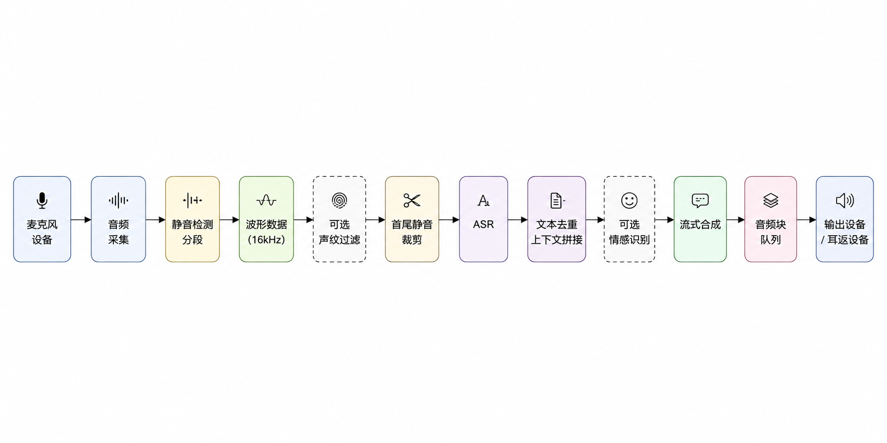
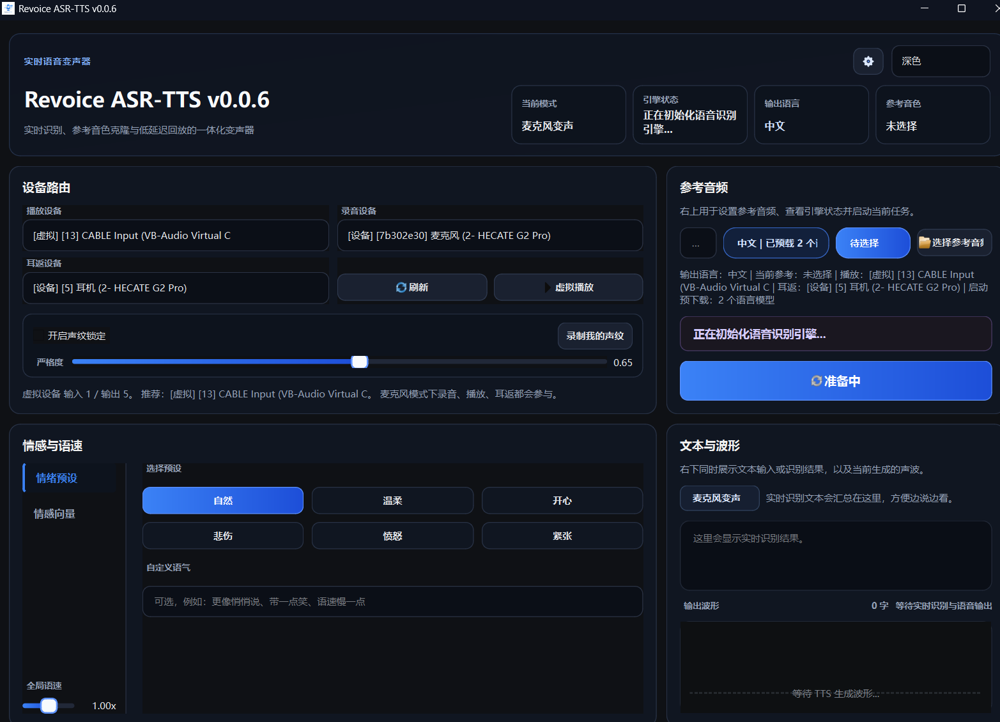
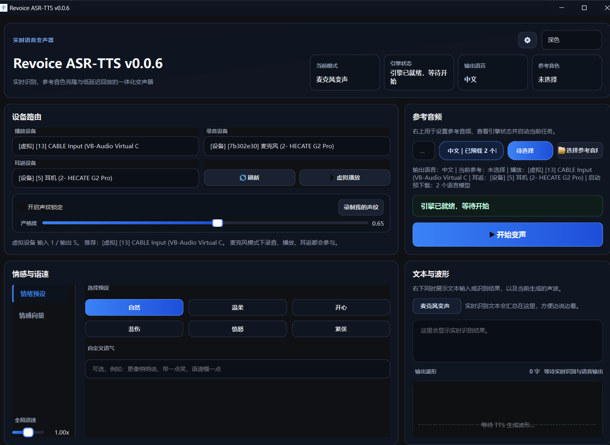
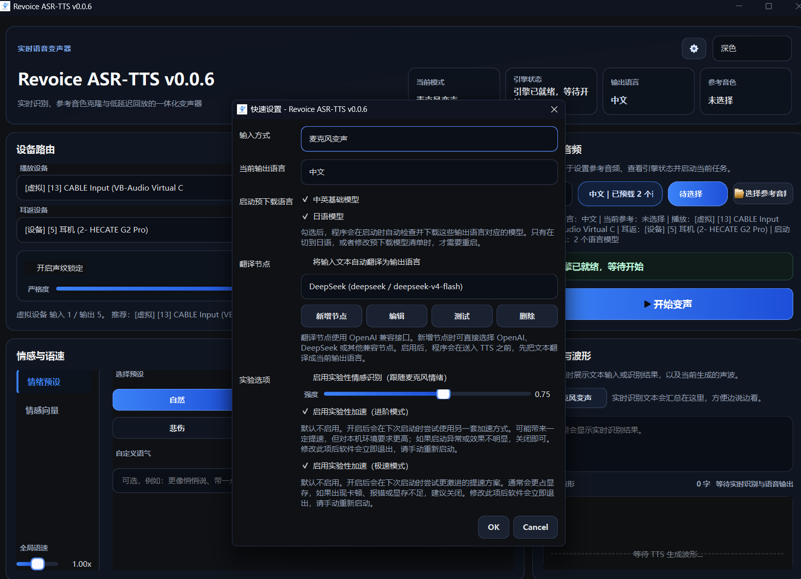

# Revoice ASR-TTS

[中文](./README.md)

`Revoice ASR-TTS` is a Windows-first desktop real-time voice conversion application built with `PySide6`, `FunASR Nano`, `IndexTTS-2`, and an experimental `emotion2vec+` emotion recognition pipeline.

## Overview

- Real-time microphone voice conversion: microphone input -> ASR -> TTS -> playback
- Text mode: enter text directly and synthesize speech
- Reference-audio voice cloning with runtime warm-up
- Experimental emotion recognition: automatically detect microphone emotion and map it to TTS emotion vectors
- Desktop UI with dual-layer startup progress bars and a workflow designed for live use

## Core Features

- `FunASR Nano` for real-time speech recognition, using `AutoModel` by default
- `IndexTTS-2` for streaming speech synthesis
- `emotion2vec+` for experimental emotion recognition
- Separate microphone, playback, and monitor device configuration
- Reference-audio warm-up to reduce first-utterance latency
- Built-in duplicate ASR text suppression to avoid sending the same sentence to TTS repeatedly

## Tech Stack

- Python `3.13`
- `PySide6`
- `torch` / `torchaudio` / `torchvision`
- `sounddevice` / `soundfile` / `librosa`
- `funasr`
- `indextts`
- `modelscope`

## Project Structure

```text
.
|- app/                  # Core config, services, and model wrappers
|- ui/                   # Qt UI, startup screen, worker threads
|- vendor/               # Vendored dependencies such as index-tts
|- bin/                  # Local runtime directory prepared manually, not distributed with the repo
|- checkpoints/          # Model directories
`- main.py               # Python entry point
```

## Principle



## Screenshots

Main window (initializing):



Main window (ready):



Quick settings and translation nodes:



## Requirements

- OS: `Windows` recommended
- Python: `3.13.x`
- GPU: an NVIDIA GPU with CUDA support is recommended for better TTS performance
- Audio setup: a working microphone, playback device, and optionally a virtual audio cable or monitor device

## Quick Start

### 1. Install Dependencies

```bash
uv sync
```

Prepare the extra runtime dependencies manually:

- `ffmpeg`: install it into your system `PATH`, or place it at `bin/ffmpeg/bin/ffmpeg.exe`
  - The Windows packaging script does **not** bundle the local `ffmpeg` directory by default; if you really need that behavior, use `-IncludeBundledFfmpeg` explicitly
  - Note: if you redistribute your own bundled `ffmpeg` binaries, follow the license of that binary build instead of treating it as covered by the root `MIT` license
  - The current local `bin/ffmpeg` example is `FFmpeg 7.1.1 full_build (gyan.dev)`, and its bundled `LICENSE` identifies it as `GPL v3`
- `flash_attn`: optional and only used by the experimental accelerated GPT path; if you want that mode, download a build matching your environment from this project's GitHub Releases and install it manually

### 2. Prepare Models

The application uses the following default directories:

- `checkpoints/IndexTTS-2`
- `checkpoints/emotion2vec_plus_base`
- `checkpoints/Fun-ASR-Nano-2512`
- `checkpoints/speech_campplus_sv_zh-cn_16k-common`

The built-in startup check currently prepares the following `IndexTTS-2` models automatically:

- `IndexTeam/IndexTTS-2`
- `xmccln/IndexTTS-2-Japanese`

The default active repository is `IndexTeam/IndexTTS-2`. If you switch to another IndexTTS-2 repository without explicitly setting a local directory, the program will download it to `checkpoints/<repo-name>`. For example, the Japanese model `xmccln/IndexTTS-2-Japanese` will default to `checkpoints/IndexTTS-2-Japanese`.

For ASR, the startup stage automatically prepares `FunAudioLLM/Fun-ASR-Nano-2512` by default, and stores it under:

- `checkpoints/Fun-ASR-Nano-2512`

Live-mode speaker filtering now uses `iic/speech_campplus_sv_zh-cn_16k-common` to extract speaker embeddings, and the model is automatically prepared under:

- `checkpoints/speech_campplus_sv_zh-cn_16k-common`

You can now also modify the following directly from the quick settings panel in the upper-right corner of the app:

- Current output language
- The `TTS` model list to check and download at startup

There are two save behaviors:

- If the change causes the active `TTS` repository to change, or if the predownload model list is modified, the app will prompt for restart, exit, and then re-check and auto-prepare required models on the next launch.
- If you only change the current output language and the underlying `TTS` repository does not change, the app will not exit directly. If the microphone is currently running, it will automatically stop the microphone session to refresh the active settings.

If you want a custom local model directory, writing it to `.env` is recommended:

```dotenv
INDEX_TTS_MODEL_REPO=xmccln/IndexTTS-2-Japanese
INDEX_TTS_MODEL_DIR=D:\models\IndexTTS-2-Japanese
```

Or set it temporarily:

```powershell
$env:INDEX_TTS_MODEL_REPO = "xmccln/IndexTTS-2-Japanese"
$env:INDEX_TTS_MODEL_DIR = "D:\models\IndexTTS-2-Japanese"
uv run python main.py
```

It is also recommended to place device initialization in `.env`:

```dotenv
TTS_DEVICE=cuda
ASR_DEVICE=cpu
EMOTION_DEVICE=cpu
```

For temporary overrides, you can still use:

```powershell
$env:TTS_DEVICE = "cuda"
$env:ASR_DEVICE = "cpu"
$env:EMOTION_DEVICE = "cpu"
```

### 3. Run The App

```bash
uv run python main.py
```

## Windows Packaging

The current Windows distribution flow no longer uses `Nuitka` or `PyInstaller`. Instead it does the following:

1. Use [build.ps1](./packaging/windows/build.ps1) to compile local `app`, `ui`, and related modules into `.pyd` files and assemble the runtime directory
2. Use [build-installer.ps1](./packaging/windows/build-installer.ps1) to build the installer from the `dist/` payload

The launcher script inside the packaged output automatically runs `uv sync --frozen` before starting `main.py`.

```powershell
powershell -ExecutionPolicy Bypass -File .\packaging\windows\build.ps1
powershell -ExecutionPolicy Bypass -File .\packaging\windows\build-installer.ps1
```

Notes:

- The packaging script does not copy the local `bin/ffmpeg/` directory by default; ask users to install `ffmpeg` separately, or use `-IncludeBundledFfmpeg` explicitly if you intentionally want to redistribute it
- Packaged builds do not ship the sample audio files under `asset/`; prepare your own reference audio when using the app
- The public repository also does not distribute local runtime content such as `bin/` and `checkpoints/`

## Usage

### Microphone Mode

1. Select a reference audio
2. Choose input, playback, and monitor devices
3. Wait until model loading and reference warm-up complete
4. Click `Start Voice Conversion`

### Text Mode

1. Switch to text mode
2. Enter the text to synthesize
3. Wait until the button changes from `Preparing` to `Start Synthesis`
4. Start streaming synthesis

## Model Notes

- Models are checked at startup
- At startup, the app automatically checks and prepares `Fun-ASR-Nano-2512`, `speech_campplus_sv_zh-cn_16k-common`, all built-in `IndexTTS-2` models, and `emotion2vec+`
- The startup screen shows the exact `IndexTTS-2` model and related resources currently being checked or downloaded
- `IndexTTS-2` currently supports switching repositories through `INDEX_TTS_MODEL_REPO`, including third-party Japanese models
- `Fun-ASR-Nano-2512` is prepared automatically via `ModelScope` by default, and can also be redirected to a local directory via environment variables
- Live-mode voiceprint filtering now uses the `CAMPPlus speaker verification` model instead of the TTS-side custom voiceprint extraction logic
- This public source repository does not include the local `bin/` runtime directory
- In packaged builds, `ModelScope`-related modules are explicitly imported in code to avoid registry loss issues

## Known Notes

- The project is currently focused on Windows desktop real-time use cases
- Title-bar theme synchronization is only supported on Windows
- TTS defaults to `cuda`, ASR defaults to `cpu`, and emotion recognition defaults to `cpu`
- First launch or first warm-up may take noticeable time
- The dependency stack is heavy, so using `uv` is recommended

## Open Source Note

This repository bundles multiple third-party models and dependencies. Before redistribution or commercial use, please verify the licenses of the related models, weights, datasets, and upstream projects yourself.

## Acknowledgements And Citations

### ASR

```bibtex
@inproceedings{gao2023funasr,
  author={Zhifu Gao and others},
  title={FunASR: A Fundamental End-to-End Speech Recognition Toolkit},
  booktitle={INTERSPEECH},
  year={2023}
}
```

### IndexTTS-2

```bibtex
@article{zhou2025indextts2,
  title={IndexTTS2: A Breakthrough in Emotionally Expressive and Duration-Controlled Auto-Regressive Zero-Shot Text-to-Speech},
  author={Siyi Zhou, Yiquan Zhou, Yi He, Xun Zhou, Jinchao Wang, Wei Deng, Jingchen Shu},
  journal={arXiv preprint arXiv:2506.21619},
  year={2025}
}
```

### Emotion Recognition

```bibtex
@article{ma2023emotion2vec,
  title={emotion2vec: Self-Supervised Pre-Training for Speech Emotion Representation},
  author={Ma, Ziyang and Zheng, Zhisheng and Ye, Jiaxin and Li, Jinchao and Gao, Zhifu and Zhang, Shiliang and Chen, Xie},
  journal={arXiv preprint arXiv:2312.15185},
  year={2023}
}
```

## License

- The repository's own source code is released under the [MIT License](./LICENSE)
- Vendored third-party code, binaries, models, and other non-original content are not covered by the root MIT license
- If you redistribute `bin/ffmpeg/` together with the project, comply with the license shipped in that directory; the current local example is a `GPL v3` build
- See [THIRD_PARTY_NOTICES.md](./THIRD_PARTY_NOTICES.md) for details
