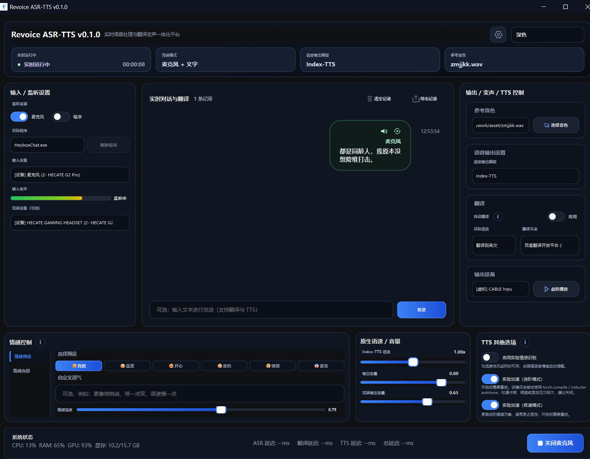
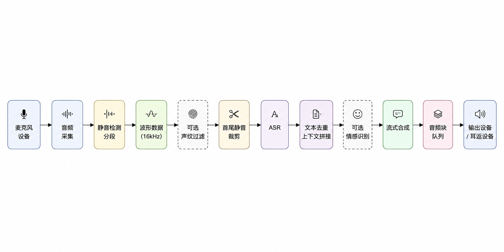
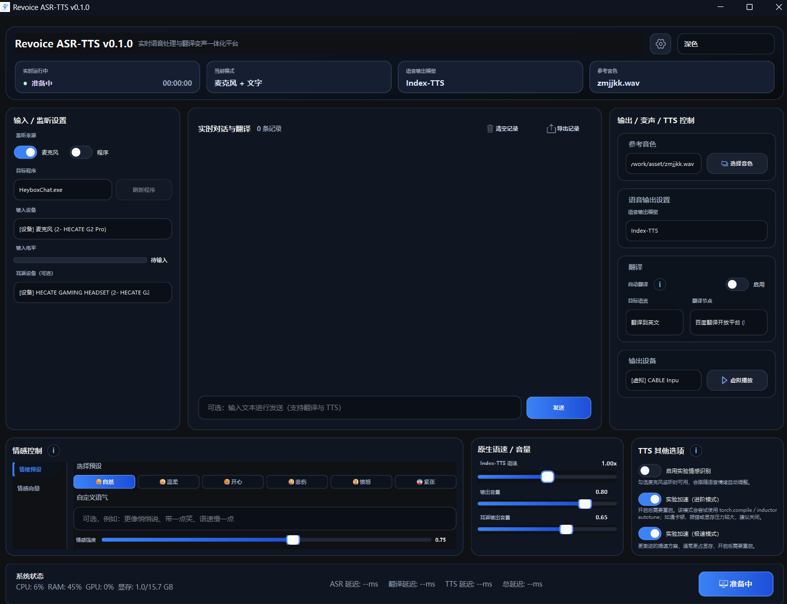
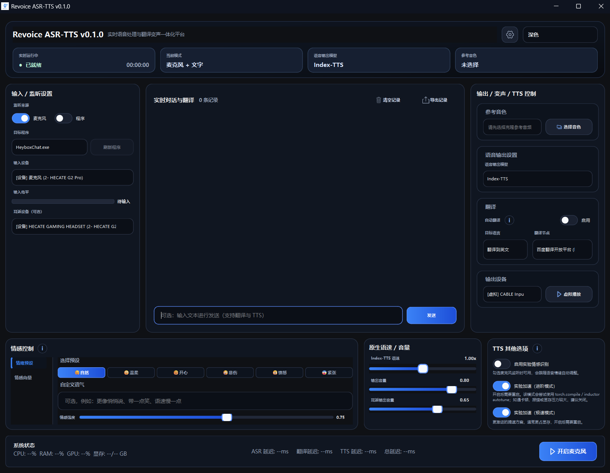
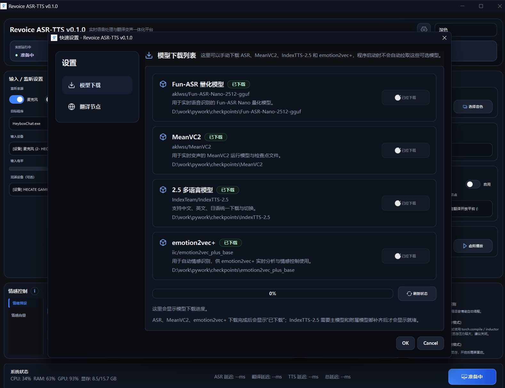

# Revoice ASR-TTS

[English](./README.en-US.md)

`Revoice ASR-TTS` 是一个面向 Windows 的实时语音工作台，基于 `PySide6`、`FunASR Nano GGUF`、`IndexTTS-2.5`、`MeanVC2` 和实验性的 `emotion2vec+` 情感识别流程构建。



## 项目简介

- 实时麦克风变声：麦克风输入 -> ASR -> TTS -> 播放输出
- 文本模式：直接输入文本并进行语音合成
- 参考音频音色克隆：支持选择参考音频并进行运行时预热
- 实验性情感识别：自动识别麦克风语音情绪并映射到 TTS 情感向量
- 桌面 UI：启动阶段带有双层进度条，主界面适合实时操作

## 核心特性

- `FunASR Nano GGUF` 用于实时语音识别
- `IndexTTS-2.5` 用于多语言流式语音合成
- `MeanVC2` 用于实时语音转换
- `emotion2vec+` 用于实验性情感识别
- 麦克风、播放、耳返设备可分别配置
- 支持麦克风、程序监听与双路输入
- 支持参考音频预热，减少首句延迟
- 内置重复 ASR 文本抑制，避免同一句连续送入 TTS

## 技术栈

- Python `3.13`
- `PySide6`
- `torch` / `torchaudio` / `torchvision`
- `sounddevice` / `soundfile` / `librosa`
- `funasr`
- `indextts`
- `modelscope`

## 项目结构

```text
.
|- app/                  # 核心配置、服务层、模型封装
|- ui/                   # Qt 界面、启动页、工作线程
|- vendor/               # 本地 vendor 依赖，例如 index-tts
|- bin/                  # 本地运行时目录，需手动准备，不随仓库分发
|- checkpoints/          # 模型目录
`- main.py               # Python 入口
```

## 运行原理



## 界面预览

主界面（初始化中）：



主界面（就绪）：



快速设置与翻译节点：



## 环境要求

- 操作系统：推荐 `Windows`
- Python：`3.13.x`
- GPU：推荐使用支持 CUDA 的 NVIDIA GPU 以获得更好的 TTS 性能
- 音频环境：建议准备可用的麦克风、播放设备，以及虚拟声卡或耳返设备

## 快速开始

### 1. 安装依赖

```bash
uv sync
```


额外运行时依赖请手动准备：

- `ffmpeg`：请自行安装到系统 `PATH`，或手动放到 `bin/ffmpeg/bin/ffmpeg.exe`
  - Windows 打包脚本默认**不会**把本地 `ffmpeg` 一起打进分发目录；如确有需要，可显式使用 `-IncludeBundledFfmpeg`
  - 注意：如果你分发自己附带的 `ffmpeg` 二进制，请按该二进制自己的许可证处理，而不是按本仓库根 `MIT` 许可证处理
  - 当前本地 `bin/ffmpeg` 示例为 `FFmpeg 7.1.1 full_build (gyan.dev)`，其随附 `LICENSE` 显示为 `GPL v3`
- `flash_attn`：可选，仅在实验性极速 GPT 路径下使用；如需启用，请从本项目 GitHub Releases 下载与你环境匹配的版本后手动安装

### 2. 准备模型

默认会使用以下目录：

- `checkpoints/IndexTTS-2.5`
- `checkpoints/emotion2vec_plus_base`
- `checkpoints/Fun-ASR-Nano-2512-gguf`
- `checkpoints/MeanVC2`

当前默认配置为：

- `IndexTTS-2.5` 默认仓库：`IndexTeam/IndexTTS-2.5`
- `ASR` 默认仓库：`aklwss/Fun-ASR-Nano-2512-gguf`
- `语音输出模型` 默认值：`MeanVC2`

设置页“模型下载”当前支持手动补齐以下资源：

- `IndexTeam/IndexTTS-2.5`
- `aklwss/Fun-ASR-Nano-2512-gguf`
- `aklwss/MeanVC2`
- `iic/emotion2vec_plus_base`

右上角快速设置现在主要用于调整：

- 翻译开关与翻译目标语言
- 当前语音输出模型（`Index-TTS` / `MeanVC2`）
- 翻译节点与实验选项

说明：

- `IndexTTS-2.5` 已按文本内容自动判定 `zh / en / ja`，首页不再单独提供“输出语言”选项
- `MeanVC2` 是语音转换模型，不依赖 `Index-TTS` 的语种切换，也不支持文本直出

如需自定义落盘目录，也推荐写到 `.env`：

```dotenv
INDEX_TTS_MODEL_REPO=IndexTeam/IndexTTS-2.5
INDEX_TTS_MODEL_DIR=D:\models\IndexTTS-2.5
ASR_MODEL_REPO=aklwss/Fun-ASR-Nano-2512-gguf
ASR_MODEL_DIR=D:\models\Fun-ASR-Nano-2512-gguf
```

或者临时指定：

```powershell
$env:INDEX_TTS_MODEL_REPO = "IndexTeam/IndexTTS-2.5"
$env:INDEX_TTS_MODEL_DIR = "D:\models\IndexTTS-2.5"
$env:ASR_MODEL_REPO = "aklwss/Fun-ASR-Nano-2512-gguf"
$env:ASR_MODEL_DIR = "D:\models\Fun-ASR-Nano-2512-gguf"
uv run python main.py
```

设备相关初始化也建议写在 `.env`：

```dotenv
TTS_DEVICE=cuda
ASR_DEVICE=cpu
EMOTION_DEVICE=cpu
```

临时覆盖时仍然可以这样写：

```powershell
$env:TTS_DEVICE = "cuda"
$env:ASR_DEVICE = "cpu"
$env:EMOTION_DEVICE = "cpu"
```

### 3. 启动应用

```bash
uv run python main.py
```

## Windows 打包

当前 Windows 分发方案不再使用 `Nuitka` 或 `PyInstaller`，而是：

1. 使用 [build.ps1](./packaging/windows/build.ps1) 将本地 `app`、`ui` 等代码编译为 `.pyd` 并组装运行目录
2. 使用 [build-installer.ps1](./packaging/windows/build-installer.ps1) 基于 `dist/` 产物构建安装包

运行目录中的启动脚本会自动执行 `uv sync --frozen`，然后再启动 `main.py`。

```powershell
powershell -ExecutionPolicy Bypass -File .\packaging\windows\build.ps1
powershell -ExecutionPolicy Bypass -File .\packaging\windows\build-installer.ps1
```

说明：

- 打包脚本默认不会复制本地 `bin/ffmpeg/`；请让用户自行安装 `ffmpeg`，或在确有需要时显式使用 `-IncludeBundledFfmpeg`
- 打包产物不会附带 `asset/` 下的示例音频，使用时请自行准备参考音频
- 仓库也不会分发 `bin/`、`checkpoints/` 等本地运行时内容

## 使用说明

### 实时模式

1. 选择输入来源：麦克风、程序监听或双路输入
2. 选择参考音频、录音、播放和耳返设备
3. 如启用程序监听，先选择目标程序并确认 PID 已刷新
4. 等待模型和参考音色预热完成
5. 点击“开始变声”

### 文本模式

1. 切换到文本模式
2. 输入要合成的文本
3. 等待右侧按钮从“准备中”切换到“开始合成”
4. 开始流式合成

说明：

- 文本模式当前仅支持 `Index-TTS`
- `MeanVC2` 当前是实时语音转换模型，不支持文本模式

## 模型说明

- 启动时会检查模型是否存在
- 当前默认 `ASR` 仓库为 `aklwss/Fun-ASR-Nano-2512-gguf`
- 当前默认 `IndexTTS` 仓库为 `IndexTeam/IndexTTS-2.5`
- 设置页可手动下载 `ASR`、`MeanVC2`、`IndexTTS-2.5` 和 `emotion2vec+`
- `IndexTTS-2.5` 会根据最终文本自动判定中、英、日语种
- `MeanVC2` 为语音转换模型，适合实时变声；`Index-TTS` 更适合文本转语音
- 当前公开源码仓库不包含 `bin/` 本地运行时目录
- Windows 打包产物中的启动脚本会先执行 `uv sync --frozen`，再启动程序

## 已知说明

- 当前项目以 Windows 桌面实时使用场景为主
- 标题栏主题联动仅在 Windows 下支持
- TTS 默认设备分配为 `cuda`，ASR 默认使用 `cpu`，情感识别默认使用 `cpu`
- 首次启动或首次预热可能较慢
- 项目依赖较多，建议使用 `uv` 管理环境

## 开源说明

本仓库聚合了多个第三方模型与依赖，请在分发或商用前自行核对相关模型、权重、数据集与上游项目的许可证条款。

## 引用与致谢

### ASR

```bibtex
@inproceedings{gao2023funasr,
  author={Zhifu Gao and others},
  title={FunASR: A Fundamental End-to-End Speech Recognition Toolkit},
  booktitle={INTERSPEECH},
  year={2023}
}
```

### IndexTTS-2.5

```bibtex
@article{zhou2025indextts2,
  title={IndexTTS2: A Breakthrough in Emotionally Expressive and Duration-Controlled Auto-Regressive Zero-Shot Text-to-Speech},
  author={Siyi Zhou, Yiquan Zhou, Yi He, Xun Zhou, Jinchao Wang, Wei Deng, Jingchen Shu},
  journal={arXiv preprint arXiv:2506.21619},
  year={2025}
}
```

### MeanVC2

```bibtex
@article{ma2026meanvc2,
  title={MeanVC2: Robust Low-Latency Streaming Zero-Shot Voice Conversion},
  author={Ma, Guobin and Xia, Yuxuan and Jiang, Yuepeng and Guo, Dake and Xie, Hanke and Hu, Jingbin and Wang, Yanbo and Xie, Lei and Zhu, Pengcheng},
  journal={arXiv preprint arXiv:2606.09050},
  year={2026}
}
```

### 情感识别

```bibtex
@article{ma2023emotion2vec,
  title={emotion2vec: Self-Supervised Pre-Training for Speech Emotion Representation},
  author={Ma, Ziyang and Zheng, Zhisheng and Ye, Jiaxin and Li, Jinchao and Gao, Zhifu and Zhang, Shiliang and Chen, Xie},
  journal={arXiv preprint arXiv:2312.15185},
  year={2023}
}
```

## 许可证

- 仓库自有代码默认采用 [MIT License](./LICENSE)
- 第三方 vendored 代码、二进制、模型与其他非自有内容不受根 MIT 许可证覆盖
- 如果你随项目一起分发 `bin/ffmpeg/`，请按该目录内随附许可证履行相应义务；当前本地示例为 `GPL v3` build
- 第三方模型、vendor 源码与二进制请分别按其各自目录中的许可证与上游说明处理
